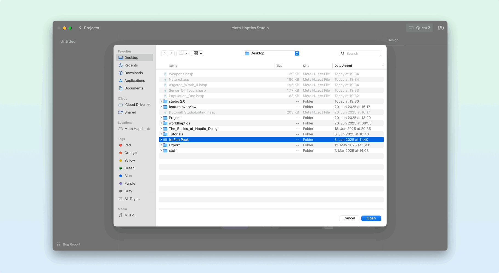

| | |
| :--- | :--- |
| **Haptics Studio** | **▸ Overview** · [Design & Integration](docs/design-and-integration/README.md) · [Source Code](docs/building.md) · [Architecture](docs/architecture.md) |
| **Haptics SDK** | [Overview](https://github.com/basslet/haptics-sdk) · [Getting Started](https://github.com/basslet/haptics-sdk/blob/main/docs/getting-started.md) · [Documentation](https://github.com/basslet/haptics-sdk/blob/main/docs/README.md) |
| **Haptics Studio Examples** | [Overview](https://github.com/basslet/haptics-studio-examples) · [Guidelines](https://github.com/basslet/haptics-studio-examples/blob/main/1%20Design%20Guidelines/README.md) · [Examples](https://github.com/basslet/haptics-studio-examples/blob/main/2%20Design%20Examples/README.md) · [Code](https://github.com/basslet/haptics-studio-examples/blob/main/3%20Integration%20%26%20Code%20Snippets/README.md) · [Knowledge](https://github.com/basslet/haptics-studio-examples/blob/main/4%20Knowledge%20Base/README.md) · [Skills](https://github.com/basslet/haptics-studio-examples/blob/main/5%20Skills/README.md) |
| **General** | [Code of Conduct](CODE_OF_CONDUCT.md) · [Contributing](CONTRIBUTING.md) · [License](LICENSE) · [Security](SECURITY.md) |

<picture>
  <source media="(prefers-color-scheme: dark)" srcset="./assets/logo-dark.png">
  <source media="(prefers-color-scheme: light)" srcset="./assets/logo-light.png">
  
</picture>

A suite of a desktop application and companion apps for designing and managing advanced haptics across your software projects. The no-code visual editor generates haptics from audio, previews them in real time on phones and VR headsets, and exports to every major haptic format, all from one interface.

<table>
  <tr>
    <th align="left">Editor</th>
    <td align="center"> macOS</td>
    <td align="center">Windows</td>
  </tr>
  <tr>
    <th align="left">Platforms</th>
    <td align="center"><a href="docs/design-and-integration/resources.md#android"> Android docs</a></td>
    <td align="center"><a href="docs/design-and-integration/resources.md#ios"> iOS docs</a></td>
    <td align="center"><a href="docs/design-and-integration/resources.md#meta-quest"> Meta Quest docs</a></td>
    <td align="center"><a href="docs/design-and-integration/resources.md#playstation"> PlayStation</a></td>
  </tr>
  <tr>
    <th align="left">Environments</th>
    <td align="center"><a href="docs/design-and-integration/resources.md#unreal-engine"> Unreal docs</a></td>
    <td align="center"><a href="docs/design-and-integration/resources.md#unity"> Unity docs</a></td>
    <td align="center"><a href="docs/design-and-integration/resources.md#fmod"> FMOD docs</a></td>
    <td align="center"><a href="docs/design-and-integration/resources.md#wwise"> Wwise docs</a></td>
    <td align="center"><a href="docs/design-and-integration/resources.md#openxr">OpenXR docs</a></td>
  </tr>
</table>

Real-time preview runs on iOS, Android and Meta Quest. PlayStation plays exported PCM; there is no preview on PlayStation. Product names and logos are trademarks of their owners; Haptics Studio is not affiliated with or endorsed by them.

*One workspace* for your entire haptics process: design from scratch, or turn your audio assets into haptics for fast, expressive effects and intuitive UI feedback.

*Audition haptics* in real time on iOS, Android and Meta Quest devices for rapid design and iteration.

*Author once, play on many platforms.* Export to `.haptic` (universal JSON format), `.ahap` (Apple Core Haptics), Android haptic arrays and `.wav` rendered audio.

*Manage complex projects* with batch import and export. Organize clips into groups, add markers and notes, and save everything as a `.hasp` project file.

*Build like a pro* with the included examples, guided tutorials and haptic packs built by experts.

## Download

Ready-to-install versions are not available yet. They will appear on the [Releases](https://github.com/basslet/haptics-studio/releases) page. Until then, [build Haptics Studio from source](docs/building.md).

Haptics Studio is built for macOS and Windows. Minimum versions will be listed here with the first ready-to-install version.

Previewing on a headset or phone needs a companion app; see [Companion apps](docs/design-and-integration/README.md#companion-apps).

## First Step... help! I'm new to haptics

- [Design & Integration](docs/design-and-integration/README.md): get started, learn the editor, and basic design and integration tips.
- [Architecture](docs/architecture.md): the technology stack and the data architecture.

Start with [Getting Started](docs/design-and-integration/getting-started.md) and the [Haptics Guidelines](docs/design-and-integration/haptics-guidelines.md).

> **Placeholder.** Links to in-depth guides in Haptics Studio Examples, such as accessibility, go here once those guides exist.

## About this Project

Teams who successfully integrated haptics once in one of their apps or games are likely to roll it out in all of their titles. Most app developers want to do the haptics work once and deploy it to all their supported platforms, providing a consistent UX for their entire user base.

The team behind the open-source Haptics Studio and SDK have been working on a cross-platform haptics standard and tools since 2014.

- Founded as Lofelt, the team built hardware and software for designing and playing back advanced haptics on mobile devices.
- Lofelt joined Meta in 2022, matured the software and rolled it out alongside Meta Quest. In that time, gaming and VR studios used the suite extensively.
- Meta open-sourced Haptics Studio and the Haptics SDK to open them up to other platforms, such as iOS and Android.

Haptics Studio is the open-source project. Meta Haptics Studio (<https://developers.meta.com/horizon/resources/haptics-studio/>) is a distribution of this project maintained and published by Meta, with additional Meta branding and documentation. This is similar to the relationship between Chromium and Google Chrome, or Code - OSS and Visual Studio Code. This repository is not affiliated with, endorsed by, or supported by Meta Platforms, Inc.

The project is maintained by Daniel ([@basslet](https://github.com/basslet)), former co-founder of Lofelt, and former Lofelt team members. If you have questions or want to collaborate, [open an issue](https://github.com/basslet/haptics-studio/issues).
